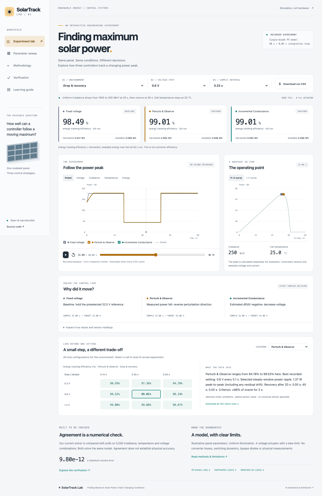
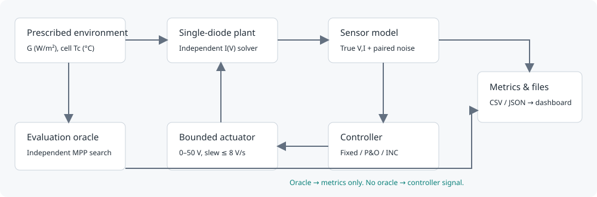

# SolarTrack Lab

**Finding Maximum Solar Power Under Changing Conditions**

A reproducible electrical-engineering simulation and interactive dashboard comparing fixed voltage, Perturb & Observe and Incremental Conductance. Explore six environments and nine controller settings, inspect sampled decisions, and download the underlying data.

**[Open the live experiment](https://khachatryann.github.io/solartrack-lab/)** · [Technical report](docs/report.md) · [Methodology](docs/methodology.md) · [Learning guide](docs/learning-guide.md) · [Verification](docs/verification.md)



This is a simulation with explicitly illustrative panel parameters. There are no physical measurements or transistor-level converter simulations. Numerical agreement with pvlib is **not physical validation**.

## Actual findings

At the default 0.6 V step / 0.25 s sample interval:

| Environment | Fixed voltage | P&O | INC |
|---|---:|---:|---:|
| Constant sunlight | 98.4536% | 99.2230% | 99.2230% |
| Drop and recovery | 98.4858% | 99.0097% | 99.0097% |
| Passing clouds | **98.4064%** | 94.2548% | 94.2548% |
| Warming cells | 91.0914% | 99.1890% | 99.1905% |
| Noisy sensors | 98.4536% | 99.0043% | 99.0238% |

Values are full-run **energy tracking efficiency**, not converter efficiency. All 162 result rows, including the ramp and unfavorable tunings, are in [results/summary.csv](results/summary.csv). Fixed voltage wins the default cloud case. At aggressive 1.2 V / 0.10 s, P&O cloud efficiency falls to 31.2896%; the report diagnoses command/actuator mismatch and a low-current hold that cannot reacquire above Voc. This failing case is retained, not optimized away.

## Run locally

The **demo itself needs only a static HTTP server**, with no account, paid API, hardware, runtime CDN or JavaScript build dependency. To reproduce the engineering workflow, use Python **3.12** (3.13 is supported by declared dependency bounds, but the delivered run used 3.12). Node 22+ is needed only for optional browser QA.

```sh
python3.12 -m venv .venv
source .venv/bin/activate
python -m pip install -r requirements-lock.txt
python scripts/generate.py
python -m pytest -q --junitxml=docs/test-results.xml
python scripts/build_site.py
python -m http.server 8000 --directory dist
```

Open [localhost:8000](http://localhost:8000). Generation normally takes tens of seconds to a few minutes depending on the host. Do not open `index.html` with `file://`; the dashboard loads local JSON over HTTP. Generated data is committed, so you can skip `generate.py` to build and view the delivered recording immediately.

For browser QA (Chromium desktop and emulated mobile):

```sh
npm ci
npx playwright install chromium
npm run test:browser
```

On Linux CI, use `npx playwright install --with-deps chromium`. The QA script runs its own temporary local server. To rerun the entire process in order, use `make verify` then `make browser` (after the browser setup above). See [docs/verification.md](docs/verification.md) for evidence and limits.

## Verification results

* **35 engineering tests passed** on the delivered run: residuals, pvlib agreement, known controller decisions, guards, voltage bounds/slew, zero light, reproducibility/noise pairing, energy units/integration, oracle isolation, all published metrics and CSV/JSON consistency.
* **5,050 signed-current comparison points** against pvlib 0.13.1; maximum absolute error **9.803713e−12 A**, tolerance `1e−8 A + 1e−8 × |reference current|`.
* Maximum MPP power/voltage errors **1.575298e−10 W / 3.595584e−7 V**, tolerances `1e−5 W / 1e−4 V`.
* Timestep refinement at **0.05, 0.025, 0.0125 s** for 15 representative scenario/controller pairs: maximum successive energy change **0.004293%**, below the declared 0.5% threshold.
* Desktop/mobile browser evidence is in [docs/browser-qa.json](docs/browser-qa.json) and [screenshots](docs/screenshots/). Mobile testing is viewport emulation, not a physical-device test.

These tests assess the supplied mathematical/software model; they do not establish physical accuracy, general stability or a universal controller ranking.

## Project map

```text
src/solartrack/
  model/          independent single-diode I(V) solver and environment scaling
  controllers/    sensor-only fixed, P&O and INC implementations
  experiments/    deterministic profiles and causal bounded-actuator runner
  evaluation/     separate oracle, metric definitions, numerical comparison
tests/            engineering and published-data consistency tests
scripts/          generation, report extraction, static build, browser QA
website/          responsive, accessible recorded-playback dashboard
results/          54 full JSON runs, curves, CSV archive, metrics and charts
docs/             report, equations, guide, diagrams, sources and evidence
.github/workflows/  numerical/data/browser CI and GitHub Pages deployment
```



## Data and interpretation

Each run contains 1,201 timestamps over 60 s with true electrical values, separate held sensor readings, controller targets/decisions and cumulative energy. The six seeded profiles cover constant light, step changes, ramps, cloud pulses, changing cell temperature and Gaussian sensor noise. Controllers share initial conditions, profiles, paired sensor noise and actuator limits. The oracle is evaluation-only and unconstrained by actuator slew.

The site labels playback as recorded. Scenario, step and sample controls select real generated files. Timeline inspection uses exact 0.25 s frames; charts and CSV/JSON retain every 0.05 s integration point. The dashboard includes five timeline signals, P–V/I–V curves, controller visibility, decision explanations, a sensor table, the full tuning grid and downloads. Full traces are available in [results/all-traces-csv.zip](results/all-traces-csv.zip).

The model excludes partial shading, bypass diodes, physical converter losses/switching and dynamic thermal/electrical storage. Fixed steady-window metrics include any residual drift. Settling is ≥98% of oracle for a 2 s dwell; it can be zero when already in band, null when not attained, or omitted for moving profiles. See the [exact numerical contract and limitations](docs/methodology.md).

## Publication and CI

The `Verify & deploy` GitHub Actions workflow checks the committed data, regenerates all experiments, reruns tests, builds the site and exercises the browser controls before deploying the static `dist` directory to GitHub Pages. Pages must use **GitHub Actions** as its source. No deployment keys or API secrets are required by the workflow. See [docs/PUBLISHING.md](docs/PUBLISHING.md) for exact commands if publication needs to be repeated.

## Attribution and license

[MIT](LICENSE) for original code, documentation and generated results. Dependencies retain their own licenses. The environmental model follows documented De Soto equations and is cross-checked with [pvlib's current solver](https://pvlib-python.readthedocs.io/en/v0.13.1/reference/generated/pvlib.pvsystem.i_from_v.html). Parameters are explicitly illustrative. See [sources](docs/SOURCES.md) and the [accurate AI-assistance statement](docs/AI_ASSISTANCE.md). No hardware work, novelty, institutional collaboration or personal engineering history is claimed.
