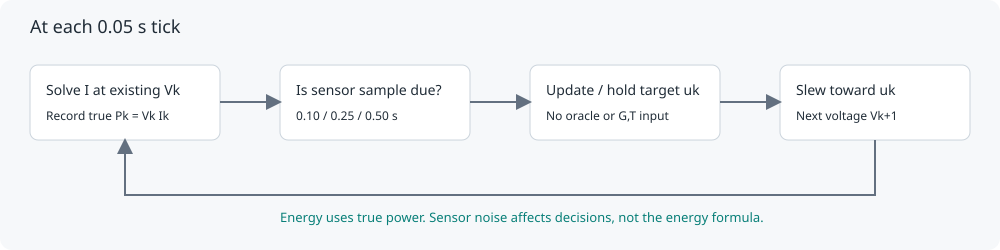

# Methodology and numerical contract

SolarTrack Lab is a reproducible simulation of maximum power point tracking (MPPT). All electrical values are modeled. No panel, sensor, converter or hardware experiment was measured. Agreement with pvlib is a numerical cross-check of a shared equation, not physical validation.

## Panel and parameter provenance

The panel is an **illustrative, unfitted crystalline-silicon module**, not a named commercial product. Its reference parameters were selected for this educational project. No manufacturer accuracy or research novelty is claimed.

| Symbol | Reference value | Meaning |
|---|---:|---|
| Gref | 1000 W/m² | Effective plane-of-array irradiance |
| Tref | 298.15 K (25 °C) | Cell temperature |
| ILref | 9.2 A | Light-generated current |
| I0ref | 1 × 10⁻⁹ A | Diode reverse saturation current |
| Rs | 0.3 Ω | Series resistance |
| Rshref | 400 Ω | Shunt resistance |
| aref | 1.8 V | n Ns kB Tref / q |
| αsc | 0.0046 A/K | Absolute photocurrent temperature coefficient |
| Egref | 1.121 eV | Assumed silicon bandgap at reference temperature |
| dEgdT | −0.0002677 K⁻¹ | Relative bandgap temperature coefficient |

The chosen aref is equivalent to approximately n = 1.168 for 60 series cells. Ns and n do not enter separately. Cell temperature is a prescribed input, not ambient temperature and not the output of a thermal model. Irradiance is effective uniform illumination, with no spectral, angle-of-incidence or geometric calculation.

The environmental scaling follows the De Soto formulation as documented in [pvlib 0.13.1 calcparams_desoto](https://pvlib-python.readthedocs.io/en/v0.13.1/reference/generated/pvlib.pvsystem.calcparams_desoto.html). Silicon bandgap defaults follow that reference; all other reference electrical parameters above are illustrative. See also De Soto, Klein and Beckman, *Solar Energy* 80 (2006), 78–88, [doi:10.1016/j.solener.2005.06.010](https://doi.org/10.1016/j.solener.2005.06.010). The paper title's use of “validation” does not apply to this project's numerical cross-check.

## Equations and units

The implicit single-diode equation is

```text
I = IL − I0 [exp((V + I Rs)/a) − 1] − (V + I Rs)/Rsh
P = V I
```

I, IL and I0 are amperes; V and a are volts; Rs and Rsh are ohms; P is watts. For T = Tc + 273.15 in kelvin and kB = 8.617333262145179 × 10⁻⁵ eV/K:

```text
IL(G,T) = (G/Gref) [ILref + αsc (T−Tref)]
Eg(T)   = Egref [1 + dEgdT (T−Tref)]
I0(T)   = I0ref (T/Tref)³ exp[Egref/(kB Tref) − Eg(T)/(kB T)]
a(T)    = aref T/Tref
Rsh(G)  = Rshref Gref/G;   Rsh(0) = ∞
Rs      = constant
```

The model accepts 0 ≤ G ≤ 1400 W/m² and −20 ≤ Tc ≤ 85 °C. The scalar solver accepts 0 ≤ V ≤ 60 V. Out-of-domain, nonfinite and invalid parameter inputs raise errors. The simulation actuator is bounded to 0–50 V. The supplied parameter family and domain avoid exponential overflow; this is not a general high-voltage/reverse-breakdown solver.

## Independent solver

`src/solartrack/model/diode.py` implements safeguarded Newton iteration without calling pvlib or a library current solver. At V ≥ 0, the signed-current root lies in [−V/Rs, IL]. The residual has positive derivative. A Newton step that leaves the current bracket is replaced by its midpoint. The solver stops at |residual| ≤ 10⁻¹¹ A, otherwise raises after 100 iterations. Voc is a separate 48-step bisection, bounded above by a log(1+IL/I0).

The signed solver allows negative current above Voc for an independent comparison with pvlib. The simulation uses `max(0, I)` as an **ideal reverse-current-blocking abstraction**. It produces zero panel power at an imposed reference above Voc. It does not model the circuit needed to impose that voltage, reverse-bias physics, capacitor discharge, or a physically passive terminal-voltage clamp. This abstraction is consequential in the aggressive P&O cloud case; see the report.

## Control loop and actuator




All controllers start with actual terminal/reference voltage 24 V and target 24 V. At t = 0, after measuring this initial operating point, the fixed baseline commands a preselected 32 V. The adaptive controllers command one positive step to begin probing. **The baseline is not optimized per scenario.** It happens to be near the model's reference MPP. Startup energy is included.

At each 0.05 s simulation timestamp:

1. Read the prescribed environment and solve current at the existing voltage.
2. Record true I, V and P. On sample ticks, form sensor readings and update the controller target.
3. Advance the ideal voltage actuator for the next timestep:

```text
u = clip(controller target, 0, 50) V
Vnext = clip(V + clip(u−V, −8 Δt, +8 Δt), 0, 50) V
```

The reference is held between controller updates. There is no additional transport delay; the next voltage responds causally with a maximum slew of 8 V/s. There are no converter switching states, inductors, capacitors, loads, transistor models or converter losses. The oracle has no slew limit, so available energy is a quasistatic upper bound, not the best energy a constrained controller could attain.

Controllers receive **only measured voltage and current**. Their import graph excludes the plant and oracle. A test replaces all oracle answers with nonsense and verifies that every control decision and actual electrical trace stays identical.

### Algorithms

* **Fixed voltage:** always requests 32 V, subject to the common slew and bounds.
* **Perturb & Observe (P&O):** compare sampled power with the previous sampled power. If ΔP < −0.02 W, reverse the previous perturbation direction; otherwise continue. Commands change by the selected step. Reflect direction at a hard command bound. The 0.02 W deadband is fixed across all runs.
* **Incremental Conductance (INC):** estimate S = I + V ΔI/ΔV (A), equivalent to dP/dV. If S > 0.05 A, increase target voltage; if S < −0.05 A, decrease it; otherwise hold. If |ΔV| < 10⁻⁴ V, avoid division: hold when |ΔI| < 10⁻⁵ A, otherwise follow sign(ΔI).

Adaptive-controller guards: hold and clear observation history for nonfinite sensors, I < 0.05 A, or V < 0.1 V. Resume with a positive startup probe once readings return to the usable range. At zero light, true power is exactly zero. Noise is not clipped before control, so negative noisy current is possible and invokes the guard. **The low-current hold is deliberately simple: it cannot distinguish darkness from a reference above Voc and has no autonomous reacquisition scan.** This is a documented controller limitation, not a missing numerical result. Slew-limited commands can accumulate ahead of actual voltage; no anti-windup policy is added to either tracker.

## Experiment matrix and random seeds

Every run lasts 60 s and uses Δt = 0.05 s. Steps: 0.2, 0.6, 1.2 V. Controller sampling: 0.10, 0.25, 0.50 s. Total: 6 environments × 9 configurations × 3 controllers = 162 controller traces. The default displayed setting is the middle of the grid, 0.6 V / 0.25 s, not a retrospectively selected winner.

| Scenario | Irradiance (W/m²) | Cell temperature | Seed |
|---|---|---|---:|
| Constant | 1000 | 25 °C | 7310 |
| Drop / recovery | 1000; 250 from 20 ≤ t < 40 s; then 1000 | 25 °C | 7311 |
| Ramp | 300→1000 over 0–30 s, then 1000→400 over 30–60 s | 25 °C | 7312 |
| Clouds | Three raised-cosine whole-panel dips | 25 °C | 7313 |
| Temperature | 1000 | 25 °C until 15 s; linear rise to 60 °C at 45 s; then hold | 7314 |
| Sensor noise | 1000 | 25 °C | 7315 |

Cloud pulse centers c = (14, 30, 47) s, half-widths w = (5, 7, 4) s, and depths d = (650, 800, 550) W/m². Each pulse subtracts d[1+cos(π|t−c|/w)]/2 within |t−c| < w from 1000 W/m². This is spatially uniform illumination. **Partial shading and bypass diodes are excluded.**

Noise scenario: independent additive Gaussian σV = 0.12 V and σI = 0.04 A, generated with NumPy `default_rng` (PCG64), seed 7315. Each scenario/sampling schedule uses the same paired normal sequence across controllers and step sizes. Finer timesteps retain the same sequence at sample instants. Different sampling intervals have different physical sampling times; their sequence is paired by sample number, not by wall-clock noise interpolation. Clean scenarios have zero sensor noise. Sensor readings are held between samples and are separate fields from true plant values. This is one noise realization, not a Monte Carlo uncertainty study.

## Metric definitions

For timestamps tk and true powers Pk:

```text
Eharvested (Wh) = Σ [(Pk+1 + Pk)/2] (tk+1 − tk) / 3600
Eavailable (Wh) = same trapezoidal sum using separately optimized Pmpp,k
ηtracking (%)  = 100 Eharvested / Eavailable
```

The oracle is independent bounded scalar maximization of V·max(0,I(V)) over [0,Voc] at every condition; it uses SciPy's bounded optimizer, voltage tolerance 10⁻⁹ V. Its answer is never fed to controllers. Available energy is null-denominator protected: tracking efficiency is null when Eavailable ≤ 10⁻¹² Wh. No tracking-efficiency clipping conceals oracle or integration errors. This is **MPPT energy tracking efficiency**, not solar conversion efficiency or power-converter efficiency.

**Steady-window oscillation:** peak-to-peak true power (max−min, W) and population standard deviation (W), including endpoints. Windows: 45–60 s for constant/noise; 50–60 s for drop/temperature. These are named fixed windows, not automatically certified steady states: slow residual drift is included. Ramp/cloud metrics are null because the environment is continuously varying. Window choice does not imply that a failing controller recovered.

**Settling/recovery:** first sample at or after a step event whose true power remains ≥98% of oracle power for a continuous 2 s dwell, ending strictly before the next event/end. Pmpp must exceed 10⁻⁶ W. Return elapsed seconds from the event. A result of 0 means it was already inside the band for the required dwell; it does not prove that the controller instantaneously identified the new MPP. Null means the criterion was not met or there was insufficient remaining time. The criterion permits leaving the band after the dwell and is not a permanent-settling guarantee. Startup at 0 s is measured separately from drop/recovery at 20 and 40 s. Moving profiles (ramp/clouds/temperature) have no step-settling metric and export an empty event list.

**Noise sensitivity:** compare constant and noisy-sensor scenarios at the same step/sampling setting, using true harvested energy and true power ripple. **Tuning sensitivity:** report all 9 settings for each tracker, without removing settings that fail or reverse rankings. No uncertainty confidence interval is claimed from a single seed.

## Verification protocol

`python scripts/generate.py` writes the exact executed grid and errors to `results/verification.json`:

* G = [0, 0.001, 0.1, 1, 10, 50, 200, 600, 1000, 1200] W/m².
* Tc = [−10, 0, 25, 50, 75] °C.
* 101 voltages evenly spaced from 0 to 50 V, including signed above-Voc behavior.
* Own current versus `pvlib.pvsystem.i_from_v(..., method='lambertw')`, passing independently calculated De Soto parameters on each side.
* Current acceptance: absolute error ≤ 10⁻⁸ A + 10⁻⁸ |Ipvlib|. MPP power absolute error ≤ 10⁻⁵ W; voltage absolute error ≤ 10⁻⁴ V. All 50 condition pairs are checked for MPP.

Refinement reruns constant, drop, clouds, temperature and noise at the default controller setting with Δt = 0.05, 0.025, 0.0125 s, retaining sample times and noise draws. Report each of 15 scenario/controller energy triples and both successive relative changes (denominator: finer energy). Threshold: 0.5% maximum change. This is a finite energy sensitivity check, not proof of continuous-time convergence of every controller trajectory or every tuning setting. Trapezoids blend a step discontinuity over half a timestep; refinement exposes its finite-grid effect.

The test suite checks independent numerical agreement, residuals, monotonic IV curves, zero/near-zero light, controlled decisions, bounds/slew, bad inputs, seed pairing, a nonuniform-time integral with a known answer, dwell logic, oracle isolation, published-metric recalculation, CSV/JSON consistency, file checksums and regenerated default traces.

## Files and playback

All 54 JSON files preserve every integration point (1201 timestamps each) plus three controller traces. JSON uses full Python float precision; archived CSV is generated from those same arrays. `summary.csv` flattens core metrics; `summary.json` additionally includes windows and settling events. `all-traces-csv.zip` holds all 54 full CSV files. `checksums.json` lists SHA-256 hashes for generated data/chart files other than itself. ZIP member timestamps are fixed for reproducibility.

The static site plays **recorded outputs**. It never runs a hidden browser approximation. Timeline inspection uses 241 exact 0.25 s frames; plots and downloads retain full 0.05 s data. IV curves use the same independent solver on a 0–50 V grid in 0.5 V increments at each frame. Displayed operating points use the actual current/power, not interpolation from this coarser curve. Configuration controls select an existing run file. Browser CSV downloads retain the entire selected run for all controllers, even when a line is hidden.

## Limitations

Uniform, quasistatic, illustrative panel; no physical calibration or validation. No spatial mismatch, multiple local maxima, reverse breakdown, bypass diodes, cell capacitance, degradation, temperature dynamics, load dynamics, switching, converter efficiency, voltage sensor bias, quantization, filtering or timing jitter. Sensor noise is ideal Gaussian and only one realization. Short 60 s examples and nine settings cannot establish a universal ranking. A tracker can fail at an aggressive setting; this implementation has no anti-windup or low-current scan. No mathematical closed-loop stability claim is made. Physical follow-up would require a characterized panel, safe converter hardware, calibrated sensors and independent laboratory review.
