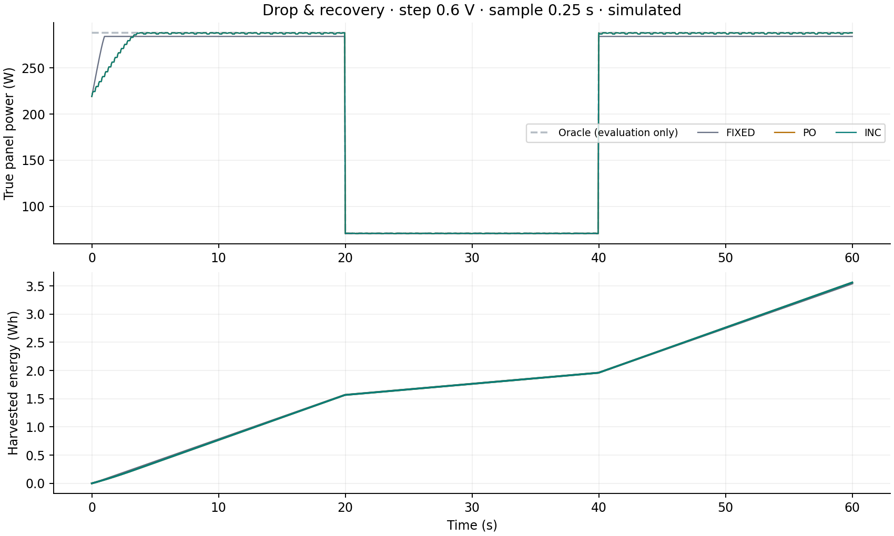
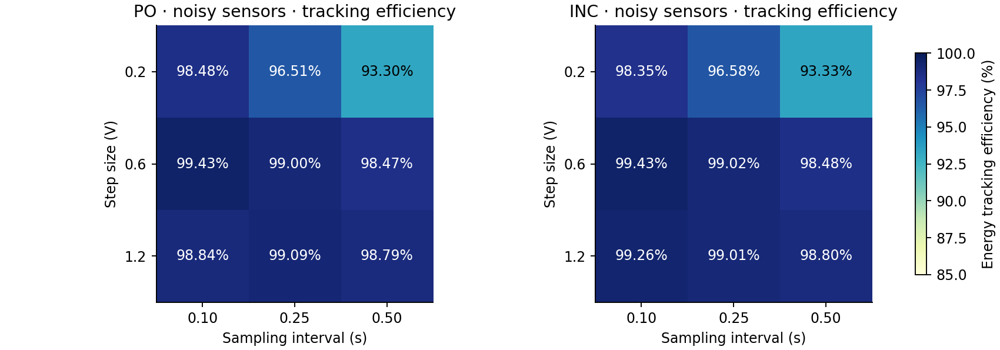

# Technical report: SolarTrack Lab

## Question and scope

How do fixed voltage, Perturb & Observe (P&O), and Incremental Conductance (INC) compare when sunlight, cell temperature, measurement noise and controller tuning change? This study is an explicitly illustrative single-diode simulation, not a hardware experiment, commercial-panel assessment, novel control contribution or physical validation.

The reproducible matrix includes 162 controller runs: six prescribed 60 s environments, three voltage steps and three sample intervals. The fixed baseline is preselected at 32 V; every strategy starts at 24 V and shares a 0–50 V, 8 V/s ideal voltage actuator. Controllers receive sampled sensor voltage/current only. A separate oracle maximizes the modeled power curve for evaluation. The full equations, units, thresholds and event definitions are in [methodology.md](methodology.md).

## Default-setting results

Step 0.6 V, sample interval 0.25 s, integration timestep 0.05 s. All efficiencies are integrated true harvested energy divided by integrated oracle energy, including startup. Displayed values below are rounded from `results/summary.json`.

| Scenario | Available (Wh) | Fixed (%) | P&O (%) | INC (%) |
|---|---:|---:|---:|---:|
| constant | 4.803053 | 98.4536 | 99.2230 | 99.2230 |
| drop | 3.595918 | 98.4858 | 99.0097 | 99.0097 |
| ramp | 3.249266 | 98.4722 | 99.2884 | 99.3720 |
| clouds | 3.919942 | 98.4064 | 94.2548 | 94.2548 |
| temperature | 4.388492 | 91.0914 | 99.1890 | 99.1905 |
| noise | 4.803053 | 98.4536 | 99.0043 | 99.0238 |

At default settings, the fixed baseline is competitive under clean constant light because its 32 V reference is close to the illustrative panel's MPP. Its 98.4536% full-run efficiency includes slewing from 24 V. This is a strong, transparent baseline, not a deliberately poor one.

Temperature change is more demanding for fixed voltage: its efficiency falls to 91.0914%, while both trackers remain near 99.19%. This result is confined to the selected model, 25→60 °C profile and tuning grid; it is not an industry-wide improvement claim.

Under the default cloud profile, **fixed voltage wins**, at 98.4064% against 94.2548% for both trackers. Comparing two consecutive noisy or changing-environment observations can confuse an environmental power change with the response to a commanded voltage change. No ranking was imposed and the cloud scenario was not removed.

P&O and INC have identical default constant, drop and cloud trajectories. This was investigated rather than treated as independent confirmation: both controllers often choose the same finite-step direction when measured voltage follows the last perturbation, and neither has perfect knowledge of environmental change. Their update rules remain different and tests exercise the distinctive INC zero-ΔV and derivative branches. Noise, other tunings and the ramp separate their behavior. Across the 54 matched environment/configuration pairs, P&O has strictly higher efficiency in 11, INC in 23, and 20 tie within 10⁻⁸ percentage points. Tiny strict differences are not practical significance.

## All settings, including failures

| Scenario | P&O range (%) | INC range (%) |
|---|---:|---:|
| constant | 96.0777–99.6071 | 92.7900–99.6071 |
| drop | 94.7811–99.5164 | 94.7831–99.5164 |
| ramp | 95.1433–99.7244 | 95.1433–99.7262 |
| clouds | 31.2896–96.7173 | 92.0000–96.7991 |
| temperature | 95.2390–99.5921 | 95.2192–99.6001 |
| noise | 93.2968–99.4255 | 93.3315–99.4279 |

The middle default setting was selected as the grid center. The full matrix shows that smaller steps with slow sampling lose startup energy; a large requested step with fast sampling can outrun the actuator. For 1.2 V per 0.10 s the nominal requested slope is 12 V/s, greater than the 8 V/s actuator limit. Commanded and actual voltages then differ, undermining the assumption that each measurement reflects the preceding complete perturbation.

The most severe recorded case is **P&O under clouds at 1.2 V / 0.10 s: 31.2896%**. Inspecting its actual trace shows 42.0 V and zero true current/power from 20 s through the end. Its target has moved beyond the modeled Voc and its I < 0.05 A guard keeps holding and clearing history. It cannot distinguish a high-voltage zero-current operating reference from darkness and contains no reacquisition scan. This is a controller/actuator-abstraction failure, not a failed IV root solve. The case is retained in every export and dashboard cell. It also depends on the documented ideal blocking/voltage-reference abstraction; a physical converter could clamp or discharge differently. No physical failure or hardware damage is claimed.

The study intentionally reports this simple implementation's behavior. Adding anti-windup, waiting for actuator arrival or a low-current reacquisition scan would be a new controller variant requiring its own complete comparison. It is not silently substituted to improve P&O's ranking.

## Noise, oscillation and recovery

The constant/noise pair has identical true conditions. Only the sensor paths differ (Gaussian σV = 0.12 V, σI = 0.04 A, seed 7315). At default settings, P&O's true power peak-to-peak ripple over 45–60 s grows from 1.3699 W to 11.1776 W; INC's grows from 1.3699 W to 8.4644 W. Harvested efficiencies change from 99.2230% to 99.0043% (P&O) and 99.0238% (INC). The fixed controller ignores sensor noise and its true trace is unchanged. These are one-seed observations, without confidence intervals or a general noise-robustness claim.

Steady-window metrics report max−min and population standard deviation of true power, including residual drift. They are not measured switching ripple. Dynamic ramp/cloud profiles have no stationary window and export null ripple metrics.

Settling means entering the ≥98%-of-oracle band for a 2 s uninterrupted dwell before the next event. Default fixed startup is 1.00 s; both trackers' startup is 3.10 s. The default drop/recovery events at 20 and 40 s report 0.00 s for all three: all are already in the wide 98% band for the dwell. This modest Voc/MPP displacement does not demonstrate instantaneous MPP identification. Null means the dwell criterion was not met or insufficient time remains. Moving profiles omit step-settling metrics. See exact event arrays in each run JSON.

## Numerical verification

The independent bracketed-Newton current solver is compared to pvlib 0.13.1's Lambert-W current solution. Each side computes its own De Soto parameters. The 5,050-point grid covers 10 irradiances (including zero and near zero), five cell temperatures, and 101 voltages from 0 to 50 V. Signed currents above Voc are compared before the simulation's blocking abstraction.

| Quantity | Actual maximum error | Acceptance |
|---|---:|---|
| Current absolute | 9.803713e-12 A | 10⁻⁸ A + 10⁻⁸ × abs(reference current) |
| Current RMS | 1.229601e-12 A | Reported, no additional threshold |
| MPP power | 1.575298e-10 W | 10⁻⁵ W |
| MPP voltage | 3.595584e-07 V | 10⁻⁴ V |

All numerical comparison tolerances passed. These are two implementations of a shared equation with illustrative parameters. **Numerical agreement is not physical validation.** It does not test whether the equations describe any particular panel accurately.

Representative constant, drop, clouds, temperature and noise experiments were rerun at Δt = 0.05, 0.025 and 0.0125 s for all three controllers, holding controller sample times and sensor sequences fixed. The maximum successive relative harvested-energy change is 0.004293% (threshold 0.5%). Every one of the 15 scenario/controller refinements passed. This supports the adequacy of the chosen timestep for these energy comparisons; it does not prove waveform convergence, stability, or adequacy for all aggressive settings. Tables of every refinement are in `results/convergence.json`.

## Reproducibility and demonstration

The dependency lock and Python 3.12 setup reproduce the complete experiment without paid APIs, accounts or hardware. `scripts/generate.py` produces traces, paired-noise data, CSV/JSON summaries, oracle results, charts, verification and file hashes. `scripts/write_report.py` extracts this report's tables and numerical verification from those files. `pytest` checks controlled decisions, limits, numerical edges, zero light, reproducibility, integration, oracle separation and consistency of every published run/metric/CSV. The test execution record is `docs/test-results.xml` and the browser QA record is `docs/browser-qa.json`.

The browser loads 54 actual configuration files. Recorded playback is labeled; it is not a live simulation. All 1,201 integration points remain in plots/downloads, while timeline inspection and IV snapshots use exact 0.25 s frames. Scenario, step, sample interval and parameter-sweep controls switch the underlying files. Line toggles, five plotted signals, P–V/I–V curves, decision explanations and electrical tables support inspection. Desktop and mobile screenshots show the same dashboard built from these data.

## Boundaries and next experiments

The model lacks physical calibration, converter circuitry/losses, thermal dynamics, capacitance, timing jitter, sensor bias, quantization, partial shading and bypass diodes. There is one uniform module and one maximum, not a multimodal shading model. The voltage-reference/current-blocking abstraction and simple guards matter to the failure cases. The 60 s duration, 9-setting grid and single noise seed are finite examples; no controller is established as universally superior.

Useful follow-ups are separately labeled controller variants with anti-windup/reacquisition, multiple noise seeds with uncertainty intervals, longer profiles, and characterized real-panel parameters. A physical build would need independent design/safety review and calibrated measurements. No such work is implied by the present repository.
